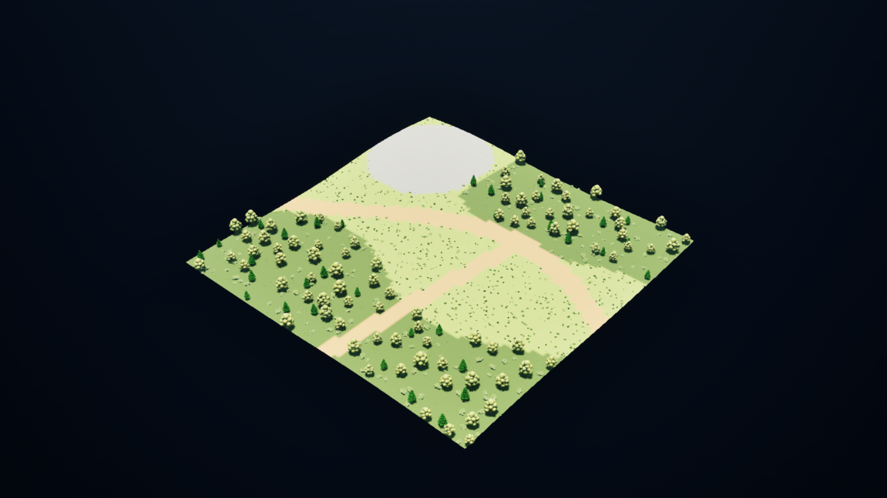
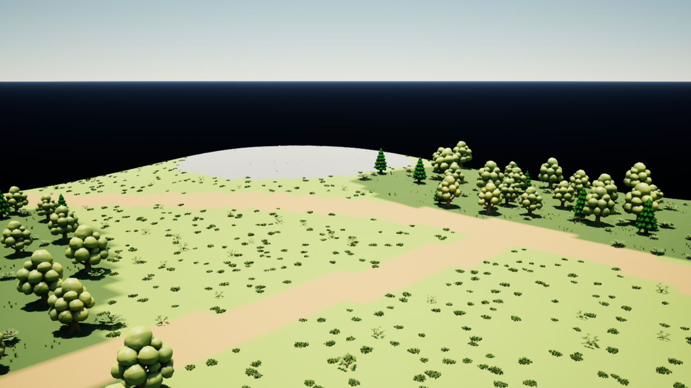

# Pixel World Builder sample

This 64×64 RGB PNG describes a 128×128 m test landscape at 2 m per pixel. It contains exactly four opaque RGB triplets, with sRGB/gAMA metadata. The tool classifies stored integers; display color management does not participate in the mapping.

| Region | Stored RGB | Generated objects |
| --- | --- | --- |
| Forest | 34, 139, 34 | Broadleaf trees, pines, spreading bushes, sparse grass |
| Meadow | 128, 196, 72 | Dense short grass, sparse bushes |
| Path | 194, 144, 88 | Clear ground |
| Rock | 128, 128, 144 | Rock instances |

`PW_Demo_Height.png` is a same-sized 16-bit grayscale image, mapped to 0–12 m. The actual source elevations range from approximately 0.95 to 6.92 m. The profile applies two height smoothing passes. Image top is +X/north; image right is +Y/east.

- Map: `/Game/Prototype/PixelWorldDemo/Maps/L_PixelWorldDemo`
- Saved profile: `/Game/Prototype/PixelWorldDemo/DA_PixelWorldDemo`
- Material and four Layer Info assets: `/Game/Prototype/PixelWorldDemo`
- Cameras: `PW_Overview` and `PW_PathView`
- Seed: `20261023`

Open **Tools > PNG 월드 빌더 열기** and select `DA_PixelWorldDemo` to inspect the rules. Select the generated root actor to regenerate this batch. Source paths are relative to the TunaSweeper project directory.

The terrain and all vegetation are generated through `PixelWorld::Generate`, the same service used by the editor panel. Test-only copies of seven existing `/Game/Nature` meshes and their materials supply the plants and rocks; HISM shader usage is enabled and saved on the copies. The originals remain unchanged. The sample material, lighting and cameras provide the presentation environment.

## Verification

After saving, `Tools/PixelWorldBuilder/verify_demo.py` opens the map in a separate rendered UE 5.7 process, checks all instance origins against the source PNG, traces every origin against actual Landscape collision, and captures both saved cameras. The script does not save or modify sample packages; before/after hashes are compared. Follow `Docs/unreal_editor_coordination.md` before running it.

See `Validation/report.json`, `Validation/Overview.png` and `Validation/PathView.png` for the recorded result. The one-off authoring code is removed after validation; the PNG inputs, editable assets and read-only verification script remain.

Verified on UE 5.7.4 with D3D12/SM6: four Landscape components, 1,371 instances across seven groups, every instance in its prescribed source RGB region, and a maximum origin-to-collision error of 0.0074 cm. Saved packages were unchanged during verification. Both 1600×900 captures were visually inspected: terrain layer regions, clear paths, trees, shrubs, grass and their shadows render correctly. The black area outside the square is the empty environment beyond this finite test terrain.

